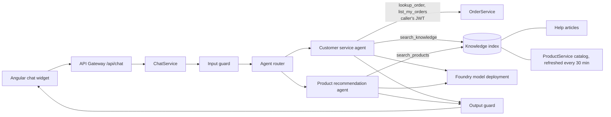

# AI assistant: architecture and governance

## Architecture

- **Agents** (`Agents/Agents.cs`): each has its own instructions and an allow-list of tools. A tool the model requests outside its agent's list is never run.
- **Order tracking**: the caller's own JWT is forwarded to OrderService, which already restricts orders to their owner. Anonymous users get `login_required`.
- **RAG**: help articles (`Knowledge/*.md`, one chunk per `##` heading) and the live product catalog are indexed in memory. Search uses embeddings (cosine) when an embedding deployment is set, otherwise BM25 keyword scoring. Unchanged chunks are not re-embedded on refresh. For a larger catalog or several replicas, replace `KnowledgeIndex` with Azure AI Search behind the same `SearchAsync` method.
- **Editing the knowledge base**: edit or add Markdown files in `Services/ChatService/ChatService.Api/Knowledge/`. The "Returns, refunds, shipping fees and delivery times" entry is intentionally a "not published" notice; replace it with the real policy and the assistant will start answering from it.

## Governance and responsible AI

| Area | Control | Where |
| --- | --- | --- |
| Transparency | Widget labels the assistant as AI, can be wrong, and offers a human | frontend `chat-widget` |
| Grounding | Answers only from tool results; never invent statuses, dates, prices, discounts, ratings, stock or policies | agent instructions |
| Scope | Declines anything other than orders, store help and products | agent instructions |
| Prompt injection | Input patterns refused; client cannot send system/tool turns; tool output and customer text treated as data; Azure Jailbreak and Indirect Attack shields | `InputGuard`, `main.bicep` |
| Output safety | Canary token and "system prompt" leak check; markdown images stripped; PII redacted | `OutputGuard` |
| Content safety | Foundry content filters (hate, sexual, violence, self-harm) at Low threshold, blocking, on prompts and completions; protected material check | `main.bicep` |
| Privacy | Card numbers, emails, phone numbers and secrets redacted before reaching the model or logs; assistant never asks for them | `PiiRedactor` |
| Data minimisation | Only order number, status, date, total and item names reach the model; no user id, address or payment data | `OrderLookupClient.ToCard` |
| Least privilege | No write tools (cannot place, cancel or pay for orders); per-agent tool allow-list; order access limited by the caller's token | `AgentRunner`, tools |
| Human oversight | `escalate_to_human` tool and empty-answer fallback show the support email | `EscalateTool` |
| Auditability | One structured log line per turn (conversation, user id, agent, tools, tokens, latency, outcome); message text logged only if `Governance:LogRedactedContent` is on; Foundry request/response logs go to Log Analytics | `AuditLog`, `main.bicep` |
| Abuse and cost | Per-user or per-address limit (`Governance:RequestsPerMinute`), message length and history caps, tool-round cap, output token cap | `Program.cs`, options |
| Feedback | Thumbs up/down recorded per conversation | `POST /api/chat/feedback` |
| Access to models | Managed identity with `Cognitive Services OpenAI User`; local keys disabled in production | `access.bicep` |

## Operating practices
- Review thumbs-down feedback and `outcome=` values other than `ok` weekly (`blocked:*`, `content_filtered`, `output_blocked`, `empty`).
- Before changing the model, system prompt or knowledge base, run the evaluation set in Foundry (quality and safety) and compare with the previous version.
- Keep log retention short (set to 30 days in `main.bicep`) and review it against your privacy policy before go-live.
- Add a privacy notice to the site that explains chat messages are processed by Microsoft Azure AI services.
- Re-run red-team prompts (jailbreaks, "ignore instructions", asking for another customer's order) after each prompt change. Unit tests in `Services/Services.Tests/ChatServiceTests.cs` cover the guardrails.

## Known limits
- Order tracking shows the store's order status only. There is no carrier, tracking link or delivery date in the order data, so the assistant cannot provide them.
- The in-memory index is per instance and rebuilt on start.
- The injection filter is pattern based; Foundry prompt shields are the stronger control and should stay enabled.
